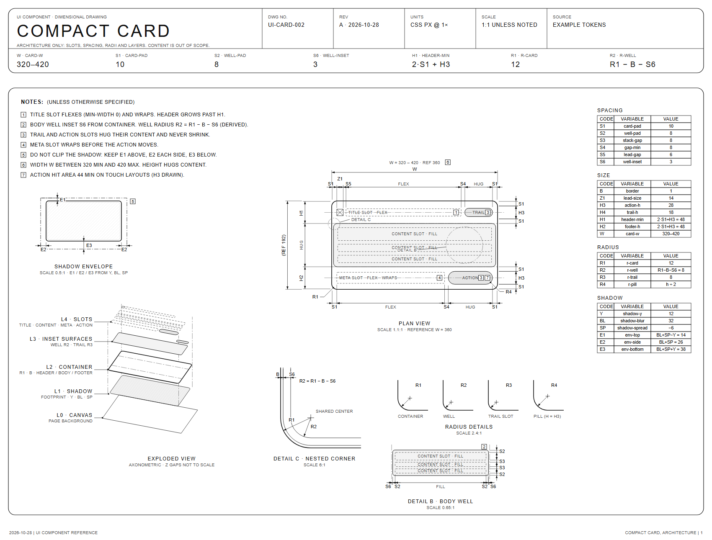

<div align="center">

# dimdraw

**Turn your card's design tokens into an Apple-style dimensional drawing, as one SVG that renders right in your README.**

The one-sheet spec drawing from [dimensional-drawing](https://github.com/enesozturk/dimensional-drawing) (1.3k stars in its first week), computed from tokens instead of hand-written per component.

Works with **Claude Code** and **Codex**.

 



<sub>This image is the real output of <code>node dimdraw.mjs -o docs/card.svg</code>, shown as an SVG. Nothing is pasted in.</sub>

</div>

## Quick start
```bash
git clone https://github.com/Dodai0419/dimdraw && cd dimdraw
node dimdraw.mjs examples/card.json -o card.svg
```
```
card.svg: Card 600x228  H1=64 R2=11 E1/E2/E3=24/56/88  39.6 KB in 88.0 ms
```
Node 18 or newer. No `npm install`, no browser, no ffmpeg.

## Gallery

**Same sheet, other tokens.** `examples/compact.json` is a 360 px card with three content rows, a
tighter padding scale and a smaller shadow. Every dimension, formula and table moved with it:



**Self-drawing version** (`--animate`): elements fade in in drawing order, plain CSS inside the SVG,
so it plays in a GitHub README or an `` tag:


| Input | Command | Output |
|---|---|---|
| upstream's reference card (default tokens) | `node dimdraw.mjs -o card.svg` | [docs/card.svg](docs/card.svg) |
| `examples/card.json` | `node dimdraw.mjs examples/card.json -o card.svg` | same drawing, tokens spelled out |
| `examples/compact.json` | `node dimdraw.mjs examples/compact.json -o compact.svg` | [docs/compact.svg](docs/compact.svg) |
| any tokens + `--animate` | `node dimdraw.mjs examples/card.json --animate -o card.svg` | [docs/card-animated.svg](docs/card-animated.svg) |

The PNG files in `docs/` are screenshots of those SVGs taken with headless Microsoft Edge.

## The problem
- The upstream drawing is an HTML page whose SVG is built by JavaScript at load time, so it does not show on GitHub, in a PR description or in most docs tools.
- Every number in the upstream example is hand-placed (`x:497, y:22, width:88`). Change one padding token and the agent rewrites a 23 KB file.
- Turning a sheet into a picture or a film needs Playwright, Chromium and ffmpeg.

## The solution
| Idea | Fixes |
|------|-------|
| **Tokens in, geometry derived** | `S1`, `H3`, `R1`, shadow `Y/BL/SP`... become every position, dimension chain and formula (`H1 = 2·S1+H3`, `R2 = R1−B−S6`, `E1..E3`). The agent writes a 382-byte JSON instead of a 23 KB page. |
| **Static SVG output** | No script at view time: it renders on GitHub, in Markdown, Figma imports and `` tags. |
| **Upstream kit, same conventions** | The dimension, callout, radius, note-box, detail-circle and table helpers and the line weights are ported from upstream, so the sheet reads the same. |
| **Checks that fail loudly** | Tokens that give a negative `R2` or no room for the title slot stop with a message instead of a broken drawing. |

## Token file
```json
{ "name": "Card", "W": 600, "Wmin": 420, "Wmax": 680, "B": 1,
  "S1": 14, "S2": 12, "S3": 12, "S4": 12, "S5": 8, "S6": 4,
  "Z1": 16, "H3": 36, "H4": 22, "TH": 20, "MH": 32, "TW": 88, "AW": 150, "content": [40, 20],
  "R1": 16, "R3": 10, "Y": 32, "BL": 72, "SP": -16, "T1": 44 }
```
Missing keys fall back to upstream's reference card. The code system (S#, H#, R#, E#, ...) is upstream's.

## Use with Claude Code
```bash
/plugin marketplace add Dodai0419/dimdraw
/plugin install dimdraw@dimdraw
```
Then: *"Make a dimensional drawing of our Card component in src/components/Card.tsx"*.

## Use with Codex (ChatGPT)
```bash
git clone https://github.com/Dodai0419/dimdraw && cp -r dimdraw/skills/* ~/.codex/skills/
```
Or copy `AGENTS.md` into your project root.

## Benchmarks
| | upstream card example | this repo |
|-|-|-|
| what the agent writes per card | 23,327 bytes of HTML + JS (`examples/card-sheet.html`) | 382 bytes of JSON (`examples/card.json`) |
| shows on GitHub / in `` | no (SVG is built by JS at load) | yes (static SVG) |
| geometry of the reference card | hand-placed numbers | the same numbers, derived from tokens (checked by `test/`) |
| one sheet render | needs a browser; not measured | 15.1 ms (avg of 200 `render()` calls) |
| CLI wall time | not measured | 0.66–0.91 s, of which bare `node -e 0` is 0.65–1.9 s on this machine |
| code | 260 lines for one card | 313 lines for any card |
| runtime deps | browser (Playwright + ffmpeg for pictures/film) | Node 18+ only |

Windows 11, Node 24.20. Commands: `node -e "import('./dimdraw.mjs').then(m=>{m.render({});const t=performance.now();for(let i=0;i<200;i++)m.render({});console.log((performance.now()-t)/200)})"`, and `wc -c` on the two input files.
The upstream page was not run here, so its timing is not measured.

## What it does not do (yet)
- Cards only. Upstream also draws dialogs and physical products.
- No camera move or MP4 like upstream's motion skill; `--animate` is a fade-in in drawing order.
- It does not measure your component for you: you (or your agent) fill the token file.

## Inspired by
- [enesozturk/dimensional-drawing](https://github.com/enesozturk/dimensional-drawing): the drawing kit, code system, line conventions and card sheet layout (MIT, see `NOTICE`).
- [Apple's accessory dimensional drawings](https://developer.apple.com/accessories/dimensional-drawings/): the style upstream follows.

## Roadmap
- [ ] Dialog sheet (viewport placement, scrim, header controls) from tokens
- [ ] `--from-css`: read tokens from CSS custom properties
- [ ] Pen-stroke draw-in for solid lines

## License
MIT
